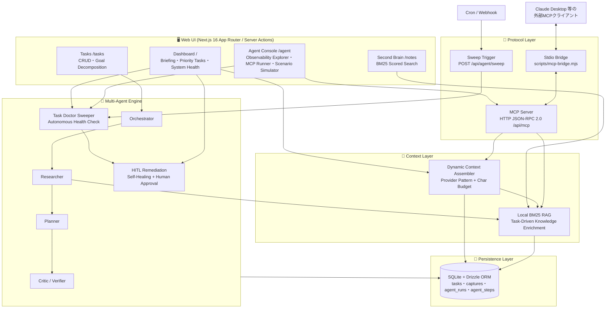
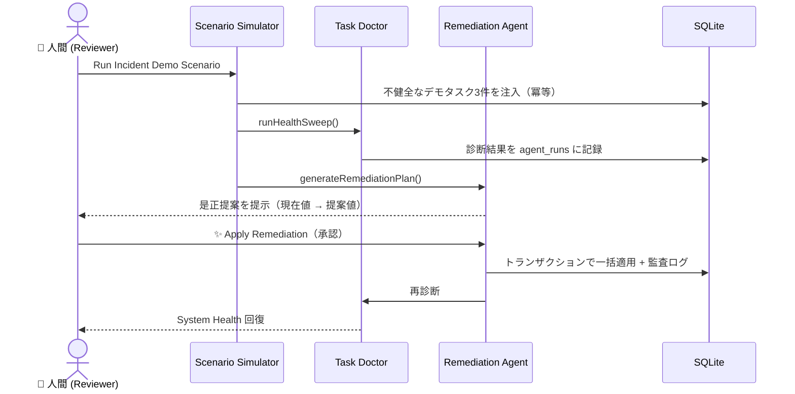
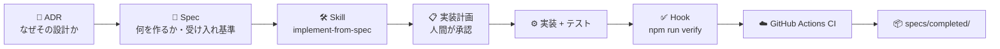

# 🧭 Personal Portal — Autonomous Agentic Platform

> **「AIに書かせる」から「AIが自律的に作り、検知し、直し、人間が承認する」へ。**
> 仕様駆動開発 × コンテキストエンジニアリング × マルチエージェント協調を、**外部LLM API課金ゼロ**で実証した自律型パーソナルポータル。

[](https://github.com/gnnsk17gm/personal-portal-agentic/actions/workflows/ci.yml)


---

## 📑 目次

1. [プロジェクト概要 & 開発思想](#-プロジェクト概要--開発思想-core-philosophy)
2. [システムアーキテクチャ](#️-システムアーキテクチャ)
3. [定量的開発メトリクス](#-定量的開発メトリクス-engineering-metrics)
4. [主要機能ハイライト](#-主要機能ハイライト)
5. [3分間デモ手順](#-3分間デモ手順-interactive-demo-walkthrough)
6. [ローカルセットアップ](#-ローカルセットアップ-quick-start)
7. [開発プロセス：仕様書と意思決定ログ](#-開発プロセス仕様書と意思決定ログ)
8. [技術スタック & ディレクトリ構成](#-技術スタック--ディレクトリ構成)

---

## 🎯 プロジェクト概要 & 開発思想 (Core Philosophy)

本プロジェクトは「LLM APIを呼び出して結果を表示するだけの **AIラッパーアプリ**」ではありません。
タスク・ナレッジ・エージェント実行履歴を一元管理するパーソナルポータルを題材に、**AIエージェントと協働してソフトウェアを作るための開発プロセスそのもの**と、**アプリ内で自律的に動くエージェント基盤**の両方を設計・実装・検証したアーキテクチャ実証プロジェクトです。

### 3つの柱

| 柱 | 何を実証したか | 実体 |
| --- | --- | --- |
| **① 仕様駆動開発 (SDD)** | 人間の役割を「コードを書くこと」から「仕様と制約を設計すること」へ移行。全15機能を仕様書起点で実装し、設計判断はADR（Architecture Decision Record：意思決定記録）として残した。 | [`specs/completed/`](specs/completed/) / [`docs/adr/`](docs/adr/) |
| **② コンテキストエンジニアリング** | AIエージェントに渡す前提知識を3階層（Rules / Skills / Hooks）に分離。常時守る憲法、再利用可能な手順書、機械的な品質ゲートを役割分担させた。 | [`.antigravity/`](.antigravity/) |
| **③ マルチエージェント協調** | アプリ内に Researcher / Planner / Critic のサブエージェント、自律巡回する Task Doctor、人間承認（HITL）付きの自己修復エージェントを実装。全実行をトレースとして永続化し可観測化した。 | [`src/services/`](src/services/) |

### 💰 完全0円 & 決定論的テスト可能な設計

- **外部LLM API課金ゼロ:** エージェントの推論（タスク分解・批評・診断・是正提案）はすべてローカルのルールベース／アルゴリズム（BM25 等）で実装。APIキー不要で `git clone` 直後から全機能が動作します。
- **決定論的（Deterministic）:** 同じ入力には常に同じ出力を返すため、エージェントの振る舞いそのものを単体テストで厳密に検証できます。現在時刻 `now` や DB をDI（依存性注入）で差し替え可能にし、テストはインメモリSQLiteで完結します。
- **差し替え可能な境界:** 外部データソースは Provider パターンで抽象化（[ADR 0003](docs/adr/0003-context-assembler-and-provider-pattern.md)）。将来 LLM や外部APIに置き換える場合も、インターフェースを変えずに実装を差し替えるだけで済みます。

---

## 🏗️ システムアーキテクチャ



### レイヤー別の責務

| レイヤー | 主要モジュール | 設計上のポイント |
| --- | --- | --- |
| **Web UI** | [`src/app/`](src/app/) / [`src/components/`](src/components/) | Server Components でデータ取得をサーバー側に閉じ込め、変更系は Server Actions + `revalidatePath` で即時反映 |
| **Context Layer** | [`contextAssemblerService.ts`](src/services/contextAssemblerService.ts) / [`searchService.ts`](src/services/searchService.ts) | 文字数予算（Char Budget）で LLM 向けコンテキストの肥大化を防止。日本語 Bi-gram トークナイザ + BM25 で外部ベクトルDB不要の RAG（検索拡張生成）を実現 |
| **Multi-Agent Engine** | [`taskDecomposerService.ts`](src/services/taskDecomposerService.ts) / [`sweeperService.ts`](src/services/sweeperService.ts) / [`remediationService.ts`](src/services/remediationService.ts) | Critic による自己修正（Self-Correction）、トランザクション + 楽観的同時実行制御による安全な是正適用、全ステップの監査ログ化 |
| **Protocol Layer** | [`mcpService.ts`](src/services/mcpService.ts) / [`mcp-bridge.mjs`](scripts/mcp-bridge.mjs) | JSON-RPC 2.0 準拠の厳格なバリデーション。ゼロ依存の Stdio⇔HTTP ブリッジで Claude Desktop と接続 |
| **Persistence Layer** | [`schema.ts`](src/db/schema.ts) / [`index.ts`](src/db/index.ts) | 初回接続時にマイグレーション自動適用。テスト時は `:memory:` に自動切替し本番DBを汚染しない |

---

## 📊 定量的開発メトリクス (Engineering Metrics)

| 指標 | 値 | 根拠 |
| --- | --- | --- |
| 🧪 **自動テスト** | **14 テストスイート / 123 テスト — 100% Green** | `npm run test:run`（[Vitest](vitest.config.ts)） |
| 📘 **完了仕様書（Specs）** | **15 件** | [`specs/completed/`](specs/completed/) |
| 🧭 **アーキテクチャ判断記録（ADR）** | **13 件** | [`docs/adr/`](docs/adr/) |
| ✅ **CI 品質ゲート** | ESLint → TypeScript Strict 型検査 → Vitest 全件 → `next build` | [`.github/workflows/ci.yml`](.github/workflows/ci.yml) |
| 💸 **外部API ランニングコスト** | **$0 / month** | LLM・ベクトルDB・SaaS API への依存ゼロ |

<details>
<summary><b>テストスイート内訳（クリックで展開）</b></summary>

| テストスイート | 件数 | 検証対象 |
| --- | ---: | --- |
| `taskDecomposerService.test.ts` | 15 | Researcher / Planner / Critic の協調と自己修正 |
| `searchService.test.ts` | 15 | 日本語トークナイズ・BM25 スコアリング |
| `mcpService.test.ts` | 14 | JSON-RPC 2.0 プロトコル準拠・ツール実行・エラーコード |
| `captureService.test.ts` | 12 | ナレッジ（キャプチャ）CRUD |
| `contextAssemblerService.test.ts` | 11 | コンテキスト統合・文字数予算・RAG 濃縮 |
| `taskService.test.ts` | 11 | タスク CRUD・優先度ソート |
| `agentContextService.test.ts` | 9 | `.antigravity/` コンテキスト読み込み・サイズ制限 |
| `sweeperService.test.ts` | 8 | Task Doctor の健全性診断 |
| `remediationService.test.ts` | 8 | 是正プラン生成・トランザクション適用・競合スキップ |
| `agentMetricsService.test.ts` | 5 | 実行メトリクス集計 |
| `mcpBridge.test.ts` | 5 | Stdio ⇔ HTTP ブリッジ |
| `mcpRunner.test.ts` | 5 | MCP 対話型ランナーのリクエスト構築 |
| `scheduleService.test.ts` | 3 | スケジュール Provider |
| `scenarioService.test.ts` | 2 | デモシナリオの冪等性 |
| **合計** | **123** | |

</details>

---

## ✨ 主要機能ハイライト

| 機能 | 概要 | 関連 Spec / ADR |
| --- | --- | --- |
| **Morning Briefing** | 今日の予定・優先タスク・関連ナレッジを Context Assembler が統合し、LLM 投入可能なコンテキストとして生成 | [Spec 005](specs/completed/005-context-assembler-and-briefing.md) / [ADR 0003](docs/adr/0003-context-assembler-and-provider-pattern.md) |
| **Second Brain（BM25 検索）** | 外部API不要のローカル全文検索。スコア付きでナレッジをランキング表示 | [Spec 006](specs/completed/006-local-bm25-search.md) / [ADR 0004](docs/adr/0004-local-retrieval-and-bm25.md) |
| **Task-Driven RAG** | 優先タスクをクエリとして関連ナレッジを自動検索し、コンテキストを濃縮 | [Spec 007](specs/completed/007-task-driven-rag-enrichment.md) / [ADR 0005](docs/adr/0005-task-driven-local-rag.md) |
| **MCP Server + Stdio Bridge** | `get_daily_briefing` / `search_knowledge_notes` / `create_portal_task` を外部AIクライアントへ公開 | [Spec 008](specs/completed/008-mcp-tools-endpoint.md)・[009](specs/completed/009-mcp-interactive-runner-and-stdio-bridge.md) / [連携ガイド](docs/mcp-claude-desktop-guide.md) |
| **Multi-Agent Goal Decomposition** | 目標を入力すると Researcher → Planner → Critic が協調してタスクに分解。全ステップをタイムライン表示 | [Spec 010](specs/completed/010-task-decomposition-agent-and-trace.md)・[011](specs/completed/011-multi-agent-orchestrator.md) / [ADR 0009](docs/adr/0009-multi-agent-orchestration-and-critic.md) |
| **Task Doctor（自律巡回）** | 期限切れ・滞留タスクを自律診断し Healthy / Warning / Critical を判定。Cron/Webhook からも起動可能 | [Spec 012](specs/completed/012-autonomous-task-doctor.md) / [ADR 0010](docs/adr/0010-autonomous-sweeper-and-scheduled-agent.md) |
| **Self-Healing + HITL** | AI が是正案を提示し、人間が承認した時のみトランザクションで一括適用。提案後にデータが変わっていれば自動スキップ | [Spec 013](specs/completed/013-agentic-task-remediation-hitl.md) / [ADR 0011](docs/adr/0011-self-healing-remediation-and-hitl.md) |
| **Agent Observability Explorer** | 総実行数・成功率・ロール別ステップ数の KPI と全実行トレースを監査 | [Spec 014](specs/completed/014-agent-observability-explorer-and-scenario-runner.md) / [ADR 0012](docs/adr/0012-agent-observability-explorer-and-scenario-runner.md) |

---

## 🎬 3分間デモ手順 (Interactive Demo Walkthrough)

`/agent` の **Scenario Simulator** を使い、**「不健全検知 → AI 是正提案 → 人間承認（HITL）による自己修復」** の自律ループをワンクリックで再現できます。



| # | 所要 | 操作 | 確認ポイント |
| --- | --- | --- | --- |
| **0** | 30秒 | `npm run dev` を起動し http://localhost:3000/agent を開く | Agent Observability Explorer の KPI カード（Total Runs / Success Rate 等） |
| **1** | 30秒 | 右上の **「Run Incident Demo Scenario」** をクリック | 「デモ障害タスク 3 件を注入し、Task Doctor と是正プランをセットアップしました」と表示される |
| **2** | 30秒 | サイドバーから **Dashboard（`/`）** へ移動 | **System Health & Task Doctor** カードが `Warning` / `Critical` に変化し、期限切れ件数・滞留高優先度件数が表示される（**不健全検知**） |
| **3** | 30秒 | 同カード内の **「AI 是正提案（Self-Healing Proposal）」** を確認 | `[Demo]` タスクごとに「理由」と「現在値 → 提案値」（例: 期日を2日後へリスケジュール、優先度調整）が並ぶ（**AI 是正提案**） |
| **4** | 30秒 | **「✨ Apply Remediation」** をクリック | 人間の承認を起点に、是正がトランザクションで一括適用され、再診断でヘルス状態が更新される（**HITL 自己修復**） |
| **5** | 30秒 | `/agent` に戻り Observability Explorer を確認 | `Autonomous System Health & Task Doctor` と `Task Remediation Execution (HITL Approved)` の実行トレースがステップ単位で記録されている |

> [!TIP]
> シナリオは何度実行しても安全です。`[Demo]` プレフィックス付きのタスクのみを削除・再注入する冪等（何度実行しても結果が同じになる）設計です。

**追加デモ（任意）:**
- `/tasks` の **Goal Decomposition Agent** に目標（例:「来月までにポートフォリオを公開する」）を入力 → Researcher / Planner / Critic の協調ステップがタイムラインに表示されます。
- `/agent` の **MCP Tools Registry** から各 MCP ツールをブラウザ上で直接実行し、JSON-RPC のリクエスト／レスポンスを確認できます。

---

## 🚀 ローカルセットアップ (Quick Start)

**前提:** Node.js 24（[`.nvmrc`](.nvmrc) で固定） / npm。APIキー・`.env`・Docker は**一切不要**です。

```bash
git clone https://github.com/gnnsk17gm/personal-portal-agentic.git
cd personal-portal-agentic
nvm use            # 任意: .nvmrc の Node.js 24 に切替
npm install
npm run verify     # ESLint → TypeScript 型検査 → Vitest 全123テスト
npm run dev        # http://localhost:3000
```

> [!NOTE]
> SQLite データベース（`sqlite.db`）は初回アクセス時に自動作成され、マイグレーションも自動適用されます。サンプルデータが必要な場合は `npm run db:seed` を実行してください。

| コマンド | 内容 |
| --- | --- |
| `npm run dev` | 開発サーバー起動 |
| `npm run verify` | 品質ゲート一括実行（[`verify-all.sh`](.antigravity/hooks/verify-all.sh)） |
| `npm run test` / `npm run test:run` | Vitest（ウォッチ / 単発） |
| `npm run build` | 本番ビルド（CI でも検証） |
| `npm run db:generate` | Drizzle マイグレーション生成 |
| `npm run db:seed` | サンプルデータ投入 |

**Claude Desktop との連携:** [`docs/mcp-claude-desktop-guide.md`](docs/mcp-claude-desktop-guide.md) を参照してください。

---

## 📐 開発プロセス：仕様書と意思決定ログ



### コンテキストエンジニアリング（3階層）

| 階層 | ファイル | 役割 |
| --- | --- | --- |
| **Rules**（常時適用） | [`00-agent-constitution.md`](.antigravity/rules/00-agent-constitution.md) / [`10-technical-standards.md`](.antigravity/rules/10-technical-standards.md) | エージェントの行動憲法・技術規約 |
| **Skills**（手順書） | [`implement-from-spec.md`](.antigravity/skills/implement-from-spec.md) / [`test-driven-verification.md`](.antigravity/skills/test-driven-verification.md) | 「分析 → 計画（人間承認）→ 実装 → 検証」の定型ワークフロー |
| **Hooks**（品質ゲート） | [`verify-all.sh`](.antigravity/hooks/verify-all.sh) | Lint / 型検査 / テストを機械的に強制 |

<details>
<summary><b>📘 完了仕様書 一覧（15件）</b></summary>

| # | 仕様書 |
| --- | --- |
| 001 | [ポータル基本レイアウト & ダッシュボード骨格](specs/completed/001-dashboard-layout-skeleton.md) |
| 002 | [SQLite + Drizzle ORM によるDB基盤とダッシュボード永続化](specs/completed/002-local-db-and-quick-capture.md) |
| 003 | [タスク管理ページと Vitest 自動検証基盤](specs/completed/003-tasks-page-and-unit-tests.md) |
| 004 | [Second Brain と Agent Context Inspector](specs/completed/004-notes-and-agent-inspector.md) |
| 005 | [動的コンテキストアセンブラと Morning Briefing](specs/completed/005-context-assembler-and-briefing.md) |
| 006 | [ローカル BM25 検索エンジン](specs/completed/006-local-bm25-search.md) |
| 007 | [タスク駆動型ローカル RAG](specs/completed/007-task-driven-rag-enrichment.md) |
| 008 | [MCP エンドポイントと公開ツール](specs/completed/008-mcp-tools-endpoint.md) |
| 009 | [MCP 対話型テスト実行環境と Stdio ブリッジ](specs/completed/009-mcp-interactive-runner-and-stdio-bridge.md) |
| 010 | [自律型タスク分解エージェントと実行トレース基盤](specs/completed/010-task-decomposition-agent-and-trace.md) |
| 011 | [階層型マルチエージェント（Researcher / Planner / Critic）](specs/completed/011-multi-agent-orchestrator.md) |
| 012 | [自律監視エージェント（Task Doctor & Health Check）](specs/completed/012-autonomous-task-doctor.md) |
| 013 | [自己修復エージェントと HITL 承認](specs/completed/013-agentic-task-remediation-hitl.md) |
| 014 | [Agent Observability Explorer とシナリオシミュレーター](specs/completed/014-agent-observability-explorer-and-scenario-runner.md) |
| 015 | [GitHub Actions CI パイプラインと本番ビルド検証](specs/completed/015-github-actions-ci-pipeline.md) |

</details>

<details>
<summary><b>🧭 アーキテクチャ判断記録（ADR）一覧（13件）</b></summary>

| # | 意思決定 |
| --- | --- |
| 0001 | [初期技術スタック（Next.js App Router + TypeScript + Tailwind CSS）](docs/adr/0001-initial-tech-stack.md) |
| 0002 | [ローカルファースト DB / ORM（SQLite + Drizzle ORM）](docs/adr/0002-database-and-orm-selection.md) |
| 0003 | [動的コンテキストアセンブラと Provider パターン](docs/adr/0003-context-assembler-and-provider-pattern.md) |
| 0004 | [外部API非依存のローカル検索（BM25）](docs/adr/0004-local-retrieval-and-bm25.md) |
| 0005 | [タスク駆動型ローカル RAG](docs/adr/0005-task-driven-local-rag.md) |
| 0006 | [MCP 準拠のエージェント連携エンドポイント](docs/adr/0006-model-context-protocol-server.md) |
| 0007 | [MCP 対話型ランナーと Stdio ブリッジ](docs/adr/0007-mcp-interactive-runner-and-stdio-bridge.md) |
| 0008 | [Plan-and-Execute 型ワークフローと実行トレース](docs/adr/0008-agent-workflow-and-execution-trace.md) |
| 0009 | [専門 Subagent の協調（Researcher / Planner / Critic）](docs/adr/0009-multi-agent-orchestration-and-critic.md) |
| 0010 | [自律監視エージェントと Webhook / Cron トリガー](docs/adr/0010-autonomous-sweeper-and-scheduled-agent.md) |
| 0011 | [自己修復エージェントと HITL 承認パターン](docs/adr/0011-self-healing-remediation-and-hitl.md) |
| 0012 | [Observability Explorer と決定論的シナリオシミュレーター](docs/adr/0012-agent-observability-explorer-and-scenario-runner.md) |
| 0013 | [GitHub Actions CI と本番ビルド整合性](docs/adr/0013-github-actions-ci-and-production-build.md) |

</details>

---

## 🛠 技術スタック & ディレクトリ構成

| カテゴリ | 採用技術 |
| --- | --- |
| **Framework** | Next.js 16（App Router / Server Actions）, React 19 |
| **Language** | TypeScript（Strict Mode） |
| **Styling** | Tailwind CSS v4, lucide-react |
| **Database** | SQLite（better-sqlite3, WAL モード）+ Drizzle ORM / drizzle-kit |
| **Agent Protocol** | Model Context Protocol（HTTP JSON-RPC 2.0 + Stdio Bridge） |
| **Testing / Quality** | Vitest, ESLint, `tsc --noEmit` |
| **CI** | GitHub Actions（Ubuntu / Node.js 24 / npm cache） |
| **AI 開発環境** | Google Antigravity（Rules / Skills / Hooks） |

```text
├── .antigravity/              # AIエージェント制御用コンテキスト基盤
│   ├── rules/                 # 常時適用される設計・コーディング憲法
│   ├── skills/                # 開発手順書（仕様実装・テスト駆動検証）
│   └── hooks/                 # 自動品質ゲート（verify-all.sh）
├── .github/workflows/ci.yml   # GitHub Actions CI
├── docs/
│   ├── adr/                   # アーキテクチャ判断記録（13件）
│   └── mcp-claude-desktop-guide.md
├── drizzle/                   # DB マイグレーション
├── scripts/mcp-bridge.mjs     # MCP Stdio ⇔ HTTP ブリッジ（ゼロ依存）
├── specs/                     # 仕様駆動開発（SDD）の SSOT（信頼できる唯一の情報源）
│   ├── templates/             # 仕様書テンプレート
│   ├── active/                # 実装中の仕様
│   └── completed/             # 完了仕様（15件）
└── src/
    ├── app/                   # ページ（/, /tasks, /notes, /agent）・Server Actions・API Routes
    ├── components/            # UI コンポーネント（dashboard / tasks / notes / agent）
    ├── db/                    # Drizzle スキーマ・接続・シード
    ├── lib/                   # MCP ランナー等のユーティリティ
    ├── services/              # ドメインロジック & エージェント（+ __tests__/）
    └── types/                 # 共有型定義
```

---

<p align="center">
  <sub>Built with Spec-Driven Development &amp; Context Engineering — zero external LLM API cost.</sub>
</p>
