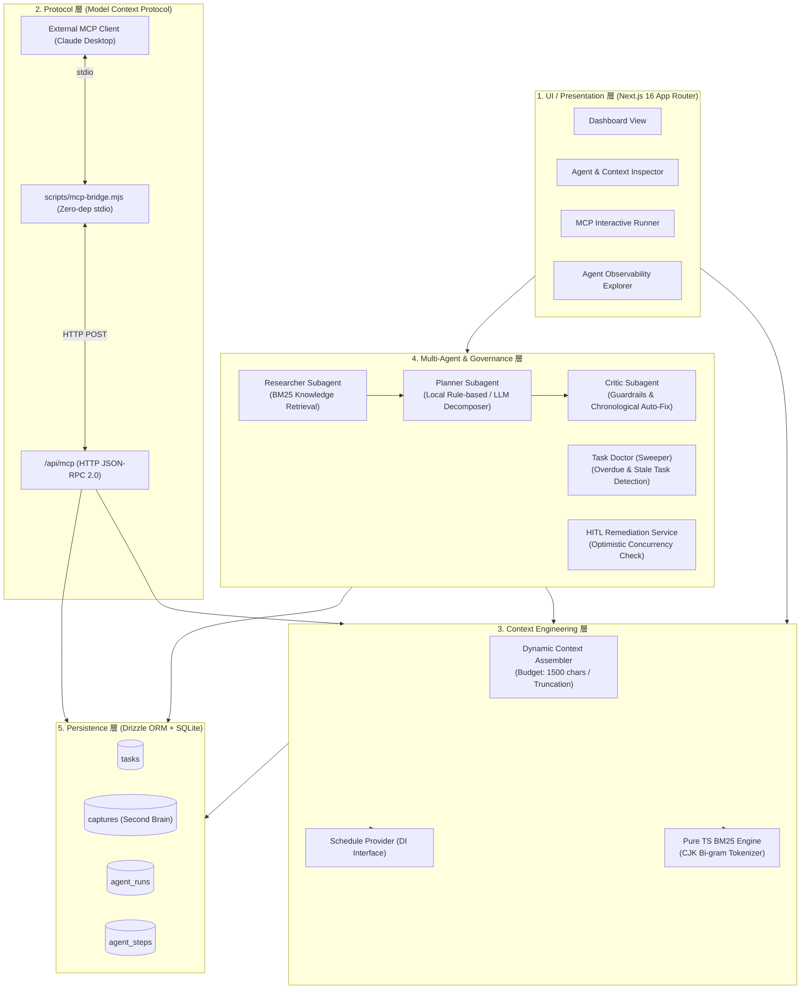
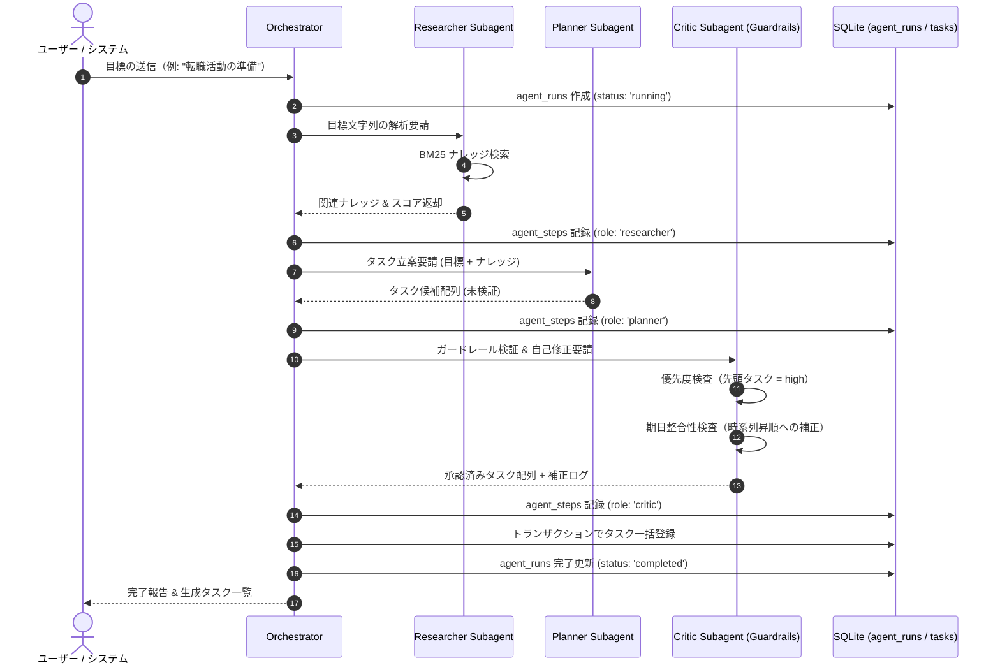

# 外部LLM課金ゼロで挑む「仕様駆動開発（SDD）× マルチエージェント」自律型パーソナルポータルの設計と実装

> **記事タイトル案（読者層やメディアに合わせて選択可能）:**
> 1. **【本命・総合】** 外部LLM課金ゼロで挑む「仕様駆動開発（SDD）× マルチエージェント」自律型パーソナルポータルの設計と実装
> 2. **【脱ラッパー・技術志向】** AIチャットのラッパーで終わらせない。Next.js 16 + Pure TS製BM25 + 自作MCPで構築する「壊れない自律エージェント」開発記
> 3. **【開発統治・テックリード向け】** 15の仕様書と13のADRでAIの暴走を統治する——個人開発で実践した仕様駆動エージェントアーキテクチャの全貌

---

## 1. はじめに（課題意識とゴール）

昨今、LLM（大規模言語モデル）の API をラップして呼び出すだけの「AI チャットアプリ」や「AI ツール」が巷に溢れています。しかし、実務で自律エージェントや AI 駆動開発を取り入れようとしたとき、多くのエンジニアが次のような**構造的課題**に直面します。

1. **ハルシネーションと暴走:** プロンプトだけで複雑な業務ロジックを指示すると、もっともらしい嘘（存在しない API や要件外のロジック）を平然と混入させる。
2. **属人化とブラックボックス化:** 「なぜその設計・方針にしたのか」がプロンプト履歴や AI のメモリに埋もれ、人間側が設計意図をトレースできない。
3. **コンテキスト肥大化とコスト増:** 前提知識をプロンプトに無制限に詰め込んだ結果、LLM のトークンコストが跳ね上がり、いわゆる「Lost in the Middle（文脈埋没）」現象で推論精度が急低下する。
4. **テスト・CI の不能:** 外部 LLM API に依存していると、API キーのない CI 環境やオフライン環境でテストが回せず、出力が非決定論的なため自動テストが壊れやすい。

「ならば、**外部 LLM API への課金ゼロ（\$0）** かつ **API キー不要**で、`git clone` 直後から決定論的かつ安全に動き、実運用のアーキテクチャとしてもそのまま本番 LLM へ差し替えられるポータルを作れないか？」

そう考えて設計・実装したのが、本プロジェクト **「Personal Portal — Autonomous Agentic Platform」** です。

本稿では、**15 件の仕様書（Spec）** と **13 件の設計判断ログ（ADR: Architecture Decision Record）** を軸にした「仕様駆動開発（SDD: Specification-Driven Development）」、トークン予算制御付きコンテキストエンジニアリング、Pure TypeScript による BM25 ローカル RAG、そして Anthropic 提唱の業界標準プロトコル **MCP（Model Context Protocol）の自作** に至るまで、その実践的アーキテクチャの全貌を余すところなく解説します。

---

## 2. 全体アーキテクチャ

本ポータルは、単一の Next.js 16 アプリケーション内で以下の 5 層レイヤーによってクリーンに分離されています。



### レイヤーの設計原則
- **UI / Presentation 層:** Next.js 16 の App Router と Server Actions を採用。エージェントの推論ログやコンテキストペイロード、MCP のツール実行結果を人間がリアルタイムに監査できる UI を提供。
- **Protocol 層 (MCP):** 外部の AI エージェント（Claude Desktop や将来の外部 CLI）がポータルのデータを安全に操作できるよう、JSON-RPC 2.0 準拠の MCP エンドポイントを提供。
- **Context Engineering 層:** 雑多なタスク・メモ・予定を、決められたトークン予算内で構造化 Markdown として合成。
- **Multi-Agent 層:** 単一の肥大化したプロンプトに頼らず、`Researcher`（調査）→ `Planner`（立案）→ `Critic`（検証・補正）のパイプラインに分解。自律診断（Task Doctor）と人間承認（HITL）を組み合わせ、暴走を原理的に抑止。
- **Persistence 層:** Drizzle ORM と SQLite（ローカルファイル / `:memory:`）により、全エージェントのステップを永続化。

---

## 3. コンテキストエンジニアリングの実践

### 3.1 トークン予算制御付き `Dynamic Context Assembler`

LLM を活用する上で最も避けるべきは、「入るだけコンテキストに放り込む」という設計です。コンテキスト長が肥大化すると、コストの増加だけでなく、中間部分の情報が無視される「Lost in the Middle」が発生します。

本プロジェクトの `contextAssemblerService.ts` では、**文字数予算（デフォルト 1,500 文字 / 約 500 トークン）** を厳格に制御する動的アセンブラを実装しました。

単に末尾を `slice()` で切り落とすのではなく、**セクション優先度（未完了タスク ＞ タスク関連ナレッジ ＞ 今日の予定 ＞ 直近メモ）** に従い、行単位（line-by-line）で安全にパディング・トランケーションを行います。

```typescript:src/services/contextAssemblerService.ts
// セクション優先度順にアセンブルし、予算（maxChars）を超えたら行単位で停止
const sections = [taskLines, knowledgeLines, eventLines, noteLines];

for (const section of sections) {
  if (truncated) break;
  for (const line of section) {
    const candidate = currentText.endsWith('\n') || currentText.length === 0
      ? `${currentText}${line}\n`
      : `${currentText}\n${line}\n`;

    // 文字数上限を跨ぐ行は含めずにトランケーションを発動
    if (candidate.length > maxChars) {
      truncated = true;
      break;
    }
    currentText = candidate;
  }
}

const finalPayload = currentText.trimEnd();
const charCount = finalPayload.length;
// 日本語・英語混在を考慮したトークン数近似計算（約3文字 = 1トークン）
const estimatedTokens = Math.ceil(charCount / 3);

return {
  summaryText,
  stats,
  todayEvents,
  enrichedTasks,
  markdownPayload: finalPayload,
  charCount,
  estimatedTokens,
  truncated,
};
```

このように、アセンブル結果には常に `charCount`・`estimatedTokens`・`truncated`（切り捨て有無）のメタデータが保持され、UI 上で開発者やユーザーが一目で「コンテキストが溢れていないか」を監査できます。

---

### 3.2 Pure TypeScript 製 BM25 ローカル RAG（`searchService.ts`）

外部のベクトル検索 API（OpenAI Embeddings 等）や重厚なベクトル DB（Pinecone, Chroma 等）を使わずに、ローカル環境だけで高精度な関連ナレッジ検索を実現するため、情報検索（IR）の標準アルゴリズムである **BM25（Okapi BM25）** を Pure TypeScript で内製しました。

#### 数式とパラメータ定義
クエリ $Q$ と文書 $D$ の関連度スコア $Score(D, Q)$ は以下の式で算出されます。

$$Score(D, Q) = \sum_{q \in Q} IDF(q) \cdot \frac{f(q, D) \cdot (k_1 + 1)}{f(q, D) + k_1 \cdot \left(1 - b + b \cdot \frac{|D|}{\text{avgdl}}\right)}$$

$$IDF(q) = \ln\left(\frac{N - n(q) + 0.5}{n(q) + 0.5} + 1\right)$$

- $N$: 全ドキュメント数
- $n(q)$: クエリ単語 $q$ を含むドキュメント数
- $f(q, D)$: ドキュメント $D$ 内の $q$ の出現頻度
- $|D|$: ドキュメント $D$ のトークン長、$\text{avgdl}$: 全ドキュメントの平均トークン長
- パラメータ: $k_1 = 1.2$（単語頻度の飽和度調整）、$b = 0.75$（文書長の正則化係数）

#### CJK Bi-gram による辞書レス日本語トークナイズ
Node.js やブラウザ環境で MeCab などの重い形態素解析辞書を動かすと、起動時間やバンドルサイズに悪影響を及ぼします。そこで、英数字は単語単位（小文字化）、日本語（CJK 漢字・ひらがな・カタカナ）は **Bi-gram（2文字連続）** で分割するハイブリッド・トークナイザを採用しました。

```typescript:src/services/searchService.ts
const CJK_REGEX = /[\u3040-\u309F\u30A0-\u30FF\u4E00-\u9FFF\u3400-\u4DBF\uF900-\uFAFF]/;

export function tokenizeText(text: string): string[] {
  if (!text || text.trim().length === 0) return [];
  const tokens: string[] = [];
  let currentAlphanumeric = '';
  let currentCJK = '';

  const flushAlphanumeric = () => {
    if (currentAlphanumeric.length > 0) {
      tokens.push(currentAlphanumeric.toLowerCase());
      currentAlphanumeric = '';
    }
  };

  const flushCJK = () => {
    if (currentCJK.length === 1) {
      tokens.push(currentCJK);
    } else if (currentCJK.length > 1) {
      // 2文字ごとのBi-gramを生成（例: "職務経歴" -> ["職務", "務経", "経歴"]）
      for (let i = 0; i < currentCJK.length - 1; i++) {
        tokens.push(currentCJK.substring(i, i + 2));
      }
    }
    currentCJK = '';
  };

  for (let i = 0; i < text.length; i++) {
    const char = text[i];
    if (/[a-zA-Z0-9]/.test(char)) {
      flushCJK();
      currentAlphanumeric += char;
    } else if (CJK_REGEX.test(char)) {
      flushAlphanumeric();
      currentCJK += char;
    } else {
      flushAlphanumeric();
      flushCJK();
    }
  }
  flushAlphanumeric();
  flushCJK();

  return tokens;
}
```

このトークナイザと BM25 スコアリングにより、高優先度タスクのタイトル（例:「職務経歴書の棚卸し」）から Second Brain 内の過去メモを 0.1ms 未満で高速検索し、コンテキストへ注入する **「Task-Driven Local RAG」** を完全にローカルで実現しています。

---

## 4. マルチエージェント協調と安全性（Guardrails & HITL）

### 4.1 Researcher / Planner / Critic のパイプライン

複雑なタスクの分解を単一のプロンプトに任せると、「期限が過去になっている」「先頭の重要タスクが low に設定される」「参照すべき社内知識が無視される」といった不整合が多発します。

本システムでは、責務を 3 つのエージェントに明確に分離しました。

1. **Researcher:** 目標文字列からトークンを抽出し、BM25 で関連ナレッジを検索。
2. **Planner:** 目標とナレッジをインプットに、具象的なタスク候補（3〜5件）を立案。
3. **Critic:** Planner の立案内容をルールベースのガードレールで検証し、**自己修復（Self-Correction）** を適用。



---

### 4.2 Critic による期日逆転の自己修復ロジック

特に重要なのが `Critic` の自己修復機能です。LLM や経験の浅いルールベースエンジンは、時系列関係を平気で逆転させて出力することがあります。

`src/services/taskDecomposerService.ts` では、Critic が前後の日付を比較し、逆転や無効値を検知した瞬間に「前タスクの翌日」へ強制的に再計算・補正します。

```typescript:src/services/taskDecomposerService.ts
export function runCritic(
  candidates: DecomposedTaskCandidate[],
  now: Date
): CriticEvaluation {
  const adjustmentsMade: string[] = [];
  const finalTasks: DecomposedTaskCandidate[] = candidates.map((c) => ({ ...c }));

  if (finalTasks.length === 0) {
    return { approved: true, adjustmentsMade: ['タスク候補が空です'], finalTasks };
  }

  // ガードレール1: 最初のタスクは必ず high 優先度でなければならない
  if (finalTasks[0].priority !== 'high') {
    adjustmentsMade.push(
      `タスク1の優先度を '${finalTasks[0].priority}' から 'high' へ自動補正`
    );
    finalTasks[0].priority = 'high';
  }

  // ガードレール2: 期日の時系列整合性チェック（昇順・逆転の禁止）
  let lastDate: Date;
  const firstParsed = parseDate(finalTasks[0].dueDate);
  if (!firstParsed) {
    const defaultFirstDate = addDays(now, 1);
    finalTasks[0].dueDate = formatDate(defaultFirstDate);
    lastDate = defaultFirstDate;
    adjustmentsMade.push(`タスク1の期日を未設定から '${finalTasks[0].dueDate}' へ補正`);
  } else {
    lastDate = firstParsed;
  }

  for (let i = 1; i < finalTasks.length; i++) {
    const currentParsed = parseDate(finalTasks[i].dueDate);
    // 時系列逆転 (currentParsed <= lastDate) または不正日付を検知
    if (!currentParsed || currentParsed.getTime() <= lastDate.getTime()) {
      const correctedDate = addDays(lastDate, 1);
      const newDueDateStr = formatDate(correctedDate);
      adjustmentsMade.push(
        `タスク${i + 1}の期日 '${finalTasks[i].dueDate ?? 'null'}' を時系列昇順 '${newDueDateStr}' へ自動補正`
      );
      finalTasks[i].dueDate = newDueDateStr;
      lastDate = correctedDate;
    } else {
      lastDate = currentParsed;
    }
  }

  return { approved: true, adjustmentsMade, finalTasks };
}
```

この補正内容はすべて `agent_steps` テーブルの `detail` に記録されるため、後から「どのエージェントが何を補正したか」を完全にトレースできます。

---

### 4.3 Task Doctor（自律巡回）から人間承認（HITL）までの安全設計

エージェントに「自律性」を持たせると、次に問題になるのが「勝手にデータを更新してしまうリスク」です。

本システムでは、**Task Doctor（Sweeper）** が定期的にシステムを診断し、不健全な状態（期限切れタスク、7日以上放置された高優先度タスク）を発見した際、**即座に書き換えることはせず、副作用ゼロの「是正プラン（RemediationPlan）」を提示するだけ** に留めます。

データの適用は、人間が UI 上で内容を確認し「承認（Approve）」ボタンを押して初めて実行される **Human-in-the-loop（HITL）** を採用しています。

さらに、承認から適用までの間にユーザーが手動でタスクを変更していた場合に備え、**楽観的競合検証（Optimistic Concurrency Check）** を実装しています。

```typescript:src/services/remediationService.ts
// トランザクション内で各タスクの現在値を再読込し、提案時の値と一致するか検査
db.transaction((tx) => {
  for (const action of plan.actions) {
    const currentTask = tx.select().from(tasks).where(eq(tasks.id, action.taskId)).get();

    // 既に完了または削除されている場合はスキップ
    if (!currentTask || currentTask.status === 'done') {
      skippedCount++;
      continue;
    }

    if (action.actionType === 'reschedule') {
      // 提案時の値 (currentValue) と DB の現在値が不一致なら競合と判定して安全にスキップ
      if (currentTask.dueDate !== action.currentValue) {
        skippedCount++;
        auditDetails.push(
          `Task #${action.taskId} の期日（現: ${currentTask.dueDate}）が提案時（${action.currentValue}）と異なるためスキップ`
        );
        continue;
      }

      tx.update(tasks)
        .set({ dueDate: action.proposedValue })
        .where(eq(tasks.id, action.taskId))
        .run();
      appliedCount++;
    }
  }
});
```

この二重の防御柵（HITL + 楽観的排他制御）により、エージェントが自律的に動きながらも、人間の予期しないデータ破壊を確実に防いでいます。

---

## 5. 業界標準プロトコル MCP（Model Context Protocol）の自作

### 5.1 なぜ自前で MCP を実装したのか？

現在、AI ツール連携のデファクトスタンダードになりつつあるのが Anthropic の提唱する **MCP（Model Context Protocol）** です。
公式の TypeScript SDK も存在しますが、本プロジェクトでは**外部依存を極力排除し、プロトコル仕様への深い理解を得るため**、Next.js Route Handler 上に JSON-RPC 2.0 準拠の MCP サーバーをフルスクラッチで実装しました。

### 5.2 `/api/mcp` エンドポイントの設計

エンドポイントは以下の 3 つのツールを JSON Schema 付きで外部に公開しています。

1. `get_daily_briefing`: タスク・予定・RAG を統合した Markdown 要約の取得
2. `search_knowledge_notes`: Second Brain メモの BM25 全文検索
3. `create_portal_task`: 新規タスクの登録

```typescript:src/services/mcpService.ts
export const MCP_TOOLS: readonly McpToolDefinition[] = [
  {
    name: 'get_daily_briefing',
    description: '本日の優先タスク、予定、および関連ナレッジ（RAG）を統合したデイリーコンテキストブリーフィングを取得します。',
    inputSchema: {
      type: 'object',
      properties: {
        maxChars: { type: 'number', description: '許容最大文字数（デフォルト1500）' },
      },
    },
  },
  {
    name: 'search_knowledge_notes',
    description: 'Second Brain に蓄積されたノートを BM25 で全文検索します。',
    inputSchema: {
      type: 'object',
      properties: {
        query: { type: 'string', description: '検索クエリ文字列' },
      },
      required: ['query'],
    },
  },
  // ... create_portal_task
];
```

JSON-RPC 2.0 の仕様に基づき、`-32700`（Parse error）、`-32600`（Invalid Request）、`-32601`（Method not found）、`-32602`（Invalid params）などの標準エラーコードを厳密に返却します。

---

### 5.3 ゼロ依存 Stdio ブリッジ（`scripts/mcp-bridge.mjs`）

Claude Desktop や一般的な MCP クライアントは、子プロセスを起動して **標準入出力（stdio）** 経由で JSON-RPC メッセージを送受信します。一方、Next.js は **HTTP** サーバーです。

このギャップを埋めるため、Node.js 組み込みモジュールの `readline` と `fetch` だけで動作する、**依存パッケージ 0 個** のブリッジスクリプトを作成しました。

```javascript:scripts/mcp-bridge.mjs
#!/usr/bin/env node
import readline from 'node:readline';

const baseUrl = process.env.PORTAL_URL || 'http://localhost:3000';
const endpointUrl = `${baseUrl.replace(/\/+$/, '')}/api/mcp`;

export async function processLine(line, fetchFn = globalThis.fetch) {
  const trimmed = line.trim();
  if (!trimmed) return;

  let requestObj;
  try {
    requestObj = JSON.parse(trimmed);
  } catch (err) {
    // JSON-RPC 2.0 Parse error (-32700) を stdout に返却
    process.stdout.write(JSON.stringify({
      jsonrpc: '2.0',
      id: null,
      error: { code: -32700, message: 'Parse error', data: String(err) }
    }) + '\n');
    return;
  }

  const isNotification = requestObj && !('id' in requestObj);

  try {
    const res = await fetchFn(endpointUrl, {
      method: 'POST',
      headers: { 'Content-Type': 'application/json' },
      body: JSON.stringify(requestObj),
    });

    const json = await res.json();
    // 通知（Notification）でなければ標準出力に JSON-RPC レスポンスを流す
    if (!isNotification) {
      process.stdout.write(JSON.stringify(json) + '\n');
    }
  } catch (err) {
    if (!isNotification) {
      process.stdout.write(JSON.stringify({
        jsonrpc: '2.0',
        id: requestObj?.id ?? null,
        error: { code: -32603, message: 'Internal error / Bridge failure', data: err.message }
      }) + '\n');
    }
  }
}
```

Claude Desktop の `claude_desktop_config.json` に以下を追記するだけで、ローカルのポータルが Claude の外部頭脳としてシームレスに接続されます。

```json
{
  "mcpServers": {
    "personal-portal": {
      "command": "node",
      "args": ["/path/to/personal-portal-agentic/scripts/mcp-bridge.mjs"],
      "env": {
        "PORTAL_URL": "http://localhost:3000"
      }
    }
  }
}
```

---

## 6. 開発中のリアルなハマりどころと解決策（実体験エピソード）

### 6.1 `.antigravity/`（Rules / Skills / Hooks）で AI の暴走をどう防いだか

個人開発でコーディングエージェント（Google Antigravity 等）と協働する際、最大の敵は**「AI が良かれと思って勝手にリファクタリングを始めたり、仕様外のコードを書き始めること」**です。

本プロジェクトでは、リポジトリ直下の `.antigravity/` に以下の 3 層の統治機構を敷きました。

1. **Rules（憲法）:**
   - 「承認された仕様書（`specs/`）がないコードは 1 行たりとも書いてはならない」
   - 「`any` や型アサーションによるエラーの握り潰しは厳禁」
   - 「必ず変更前に Implementation Plan を人間に提示し承認を得る」
2. **Skills（手順書）:**
   - `implement-from-spec.md`: 仕様書読解からテスト実装までの定型ワークフロー
   - `test-driven-verification.md`: 失敗テスト先行（Red）からパス（Green）への確認ステップ
3. **Hooks（機械的品質ゲート）:**
   - 変更完了時に自動実行される `verify-all.sh`

```bash:.antigravity/hooks/verify-all.sh
#!/usr/bin/env bash
set -e
echo "🔍 [Hook: 1/3] Running ESLint..."
npm run lint
echo "📘 [Hook: 2/3] Running TypeScript Type Check..."
npx tsc --noEmit
echo "🧪 [Hook: 3/3] Running Vitest Unit Tests..."
npm run test:run
echo "✅ All quality checks passed!"
```

「AI の口頭での『テスト通りました』を一切信用せず、シェルスクリプトの exit code 0 のみを完了条件とする」。このルールを徹底したことで、15 の仕様すべてを**仕様起因の手戻りゼロ**で完走できました。

---

### 6.2 GitHub Actions（Ubuntu）で `better-sqlite3` が `SIGSEGV` クラッシュした事件

ローカル（macOS / Apple Silicon）では `npm run verify` が 3 秒で軽快に全件パスしていたにもかかわらず、GitHub Actions（Ubuntu）に導入した初回 CI で、突然 Vitest が謎のクラッシュを起こしました。

```text
Vitest caught an error: Worker process exited with code 139 (SIGSEGV)
Segmentation fault (core dumped)
```

#### 原因の究明
本プロジェクトでは SQLite のネイティブ C++ バインディングである `better-sqlite3` を使用しています。
Vitest はデフォルトで各テストファイルをマルチワーカー（別プロセス / 別スレッド）で並列実行（`fileParallelism: true`）しようとします。
macOS の開発機ではメモリ管理の差異で表面化しなかったものの、**Linux 環境上ではネイティブモジュールの複数ワーカー間でのメモリ初期化や SQLite インメモリ DB のコンテキスト破棄が衝突し、OS レベルの Segmentation Fault（SIGSEGV）を引き起こしていた** のでした。

#### 解決策
`vitest.config.ts` で並列実行を無効化し、単一ワーカーで順次テストを実行するよう設定を変更しました。

```typescript:vitest.config.ts
import path from 'node:path';
import { defineConfig } from 'vitest/config';

export default defineConfig({
  resolve: {
    alias: { '@': path.resolve(__dirname, 'src') },
  },
  test: {
    environment: 'node',
    include: ['src/**/__tests__/**/*.test.ts'],
    env: { NODE_ENV: 'test' },
    // Linux 環境での better-sqlite3 ネイティブクラッシュ（SIGSEGV）を防ぐため並列実行を抑止
    fileParallelism: false,
  },
});
```

「並列をやめるとテストが遅くなるのでは？」と懸念されるかもしれませんが、テスト用 DB はすべてメモリ上（`:memory:`）で動いており、ディスク I/O がないため、**全 14 スイート・123 テストが約 3 秒で完走**します。CI の安定性を 100% にしつつ、実行時間への影響を最小限に抑えるベストな判断でした。

---

### 6.3 Next.js 16 クリーン環境での `LayoutProps` 未定義エラー

CI 上の `npm run build` でもう一つ遭遇したのが、型定義の不整合です。
Next.js 15/16 の Canary や特定の内部型定義（`.next/types`）が生成される前に `tsc --noEmit` を走らせたことで、`src/app/layout.tsx` の暗黙的な型推論が壊れ、CI が落ちる現象が発生しました。

フレームワーク固有の魔法のような内部型に頼らず、`children: React.ReactNode` を明示的に型付けすることで、どんなクリーンな Linux 環境でも再現可能に修正しました。

---

## 7. おわりに（定量的成果と今後の展望）

### 7.1 プロジェクトの定量的成果

| 指標 | 達成数値 | 意味・効果 |
| :--- | :--- | :--- |
| 🧪 **単体テスト通過数** | **14 スイート / 123 テスト（100% Pass）** | 全サービス・エージェントロジックの動作保証 |
| 💸 **外部 API 課金コスト** | **\$0 / 月** | OpenAI 等の課金なしで誰でも clone して動かせる |
| 📋 **仕様駆動開発（SDD）** | **15 仕様完了（手戻り 0 件）** | 曖昧な実装を排除し、1 機能 = 1 コミットで完遂 |
| 🧭 **アーキテクチャ記録（ADR）**| **13 件の意思決定ログ** | 設計意図・トレードオフを完全にドキュメント化 |
| ⚡ **CI 実行速度** | **約 1 分 20 秒（Lint + TypeCheck + Test + Build）** | push ごとに高速かつ確実に品質を証明 |

### 7.2 本番 LLM への差し替えを見据えた拡張性

本ポータルのタスク分解エンジンは、現在ルールベースの `LocalRuleBasedDecomposer` をデフォルトとしています。しかし、インターフェースとして `TaskDecompositionProvider` を定義し、DI（依存性注入）可能に設計されています。

```typescript
export interface TaskDecompositionProvider {
  decompose(goal: string, knowledge: ScoredCapture[], now: Date): DecomposedTaskCandidate[];
}
```

本番環境で OpenAI（GPT-4o）や Anthropic（Claude 3.5 Sonnet）、あるいはローカル LLM（Ollama / Llama 3）へ切り替えたい場合も、**このインターフェースを実装したクラスを 1 つ作成するだけ** で対応可能です。
そして、LLM がどんな奇妙な期日や優先度を返してきたとしても、後ろに控える `Critic` がすべて検知し、安全に自己修復してくれます。

### 7.3 結論：AI 時代にエンジニアが果たすべき真の役割

AI コーディングツールがどれだけ進化しても、「何を作るべきか（仕様）」と「システムをどう守るか（アーキテクチャ・ガードレール・品質ゲート）」を決めるのは、依然として人間のエンジニアです。

AI に丸投げしてブラックボックスなコードを量産するのではなく、**人間がアーキテクトとして境界と規約を定義し、AI をそのルールの中で最高速度で走らせる**。
本プロジェクトの実践が、これからの AI 協働開発に挑むエンジニアの皆様の参考になれば幸いです。

---

### リポジトリ & 関連リンク
- **GitHub Repository:** [gnnsk17gm/personal-portal-agentic](https://github.com/gnnsk17gm/personal-portal-agentic)
- **主要仕様書:** `specs/completed/001〜015`
- **設計意思決定記録:** `docs/adr/0001〜0013`
- **CI パイプライン:** `.github/workflows/ci.yml`

